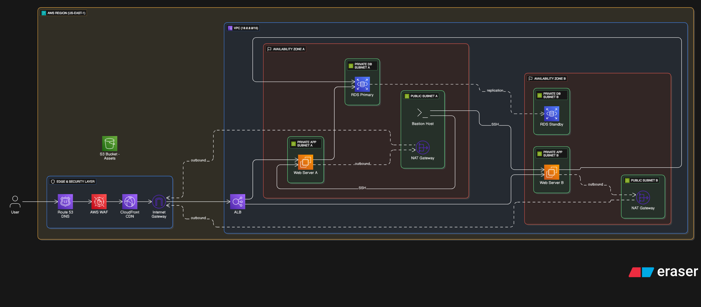

# FreshMart – Hybrid Polyglot Cloud Architecture on AWS

Cloud solution design and proof-of-concept build for **FreshMart**, a Sri Lankan organic food SME moving from manual operations, local advertising and in-person sales to a secure, scalable online store on AWS.

> Built for the *Enterprise Cloud and Infrastructure Automation* module (Staffordshire University, BSc (Hons) Computer Science – Cloud Technologies). The core networking, compute, storage and database layers were built by hand in the AWS Academy Learner Lab (us-east-1).

<p align="center">
  
</p>

**Full report:** [Download the project report (PDF)](https://github.com/Sanda1113/freshmart-aws-hybrid-architecture/raw/main/FreshMart-AWS-Report.pdf)

---

## Business requirements

| ID | Requirement | Why it matters | AWS services |
|---|---|---|---|
| BR1 | Scalable compute | Handle seasonal sales spikes without manual work | Amazon EC2, Auto Scaling |
| BR2 | Hybrid storage | Cheap storage for product images, fast block storage for databases | Amazon S3, Amazon EBS |
| BR3 | Polyglot database | Structured inventory data and very fast shopping-cart access | Amazon RDS (inventory), DynamoDB (cart) |
| BR4 | Global performance | Fast page loads across Sri Lanka and export markets | CloudFront, Route 53 |
| BR5 | Security & compliance | Protect customer PII; keep databases off the public internet | VPC private subnets, IAM, KMS |

## Architecture

A **3-tier hybrid architecture** inside a custom VPC (`10.0.0.0/16`) across **two Availability Zones**, built to the AWS Well-Architected Framework.

| Tier | Design |
|---|---|
| **Edge & security** | Route 53 DNS → AWS WAF → CloudFront CDN → Internet Gateway |
| **Presentation** | Static single-page storefront on Amazon S3, served through CloudFront |
| **Logic** | EC2 web servers (Apache/PHP) in private app subnets in each AZ, behind an Application Load Balancer; bastion host for SSH administration |
| **Data** | *Polyglot persistence*: RDS MySQL (primary + standby across AZs) for orders and inventory, DynamoDB for shopping-cart data |
| **Networking** | Public and private subnets per AZ, NAT Gateways so private servers can get updates without being exposed |

---

## What was built in the lab

All resources were built in **us-east-1** within the Learner Lab's IAM rules and $5 session budget.

**Networking**
- Custom VPC `FreshMart-Adv` (`10.0.0.0/16`)
- 4 subnets across `us-east-1a` and `us-east-1b`: public subnets for the web tier, private subnets for the data tier
- Internet Gateway with a public route table (`0.0.0.0/0` → IGW)
- NAT Gateway with an Elastic IP, so private subnets can reach the internet for updates only

**Security & identity**
- Security group `FreshMart-Web-SG` allowing HTTP (80) and SSH (22)
- Pre-provisioned `LabRole` / `LabInstanceProfile` attached to EC2 for access to S3 and DynamoDB

**Compute**
- EC2 instance `FreshMart-AppServer` (t3.micro, Amazon Linux 2023) in the public subnet
- User Data script installs Apache (httpd) and PHP automatically at launch
- Checked through the public IP, which returned the custom *"FreshMart Backend Alive"* page

**Static website**
- S3 bucket with static website hosting and a public-read bucket policy (`s3:GetObject`)
- The FreshMart single-page store (`index.html`, with shopping-cart logic) served from the S3 website endpoint

**Database**
- DynamoDB table `FreshMart_Orders`, partition key `OrderID`, on-demand capacity, status *Active*

### Designed but not deployed

| Service | Role | Reason it wasn't deployed in the lab |
|---|---|---|
| Amazon RDS | Relational database for inventory | Takes 15–20 minutes to start and uses the $5 budget; DynamoDB was used to prove the data layer |
| CloudFront | CDN | Learner Lab policy blocks `cloudfront:CreateDistribution` |
| Route 53 | DNS | Registering a real domain (e.g. `freshmart.lk`) isn't possible in the lab |

---

## Design highlights

- **Custom VPC instead of the default VPC:** the default VPC has only public subnets, and BR5 needs private subnets to isolate the database.
- **S3 for the frontend:** serverless, cheaper than running EC2 for static files, and built for 11 nines of durability.
- **DynamoDB for carts:** serverless, ready instantly, single-digit-millisecond reads for cart data.
- **t3.micro burstable instances:** cost-effective for uneven web traffic, with full OS control for the Apache/PHP stack.
- **CAPEX → OPEX:** pay-as-you-go S3 and DynamoDB replace up-front server purchases.

## Evidence

The full report contains screenshots of every step:

**[Download the report (PDF)](https://github.com/Sanda1113/freshmart-aws-hybrid-architecture/raw/main/FreshMart-AWS-Report.pdf)**

- VPC, subnets, Internet Gateway, route table, NAT Gateway and Elastic IP
- Security group inbound rules and the LabRole permissions
- EC2 launch settings and the live "FreshMart Backend Alive" page
- S3 bucket, uploaded site, bucket policy and the live storefront
- The DynamoDB table in the *Active* state

---

## Repository structure

```
freshmart-aws-hybrid-architecture/
├── docs/
│   └── architecture/
│       └── freshmart-architecture.png
├── FreshMart-AWS-Report.pdf
└── README.md
```

## Tech stack

Amazon VPC · EC2 · Amazon S3 (static website hosting) · DynamoDB · Amazon RDS (MySQL) · NAT Gateway · Internet Gateway · Elastic IP · Security Groups · IAM · Application Load Balancer · CloudFront · Route 53 · AWS WAF · Apache · PHP · Amazon Linux 2023

## Author

**Sandakan Liyanage** – [LinkedIn](https://www.linkedin.com/in/sandakan-liyanage-2baa9a207/) · [Portfolio](PORTFOLIO_URL) · [GitHub](https://github.com/Sanda1113/Sanda1113)
